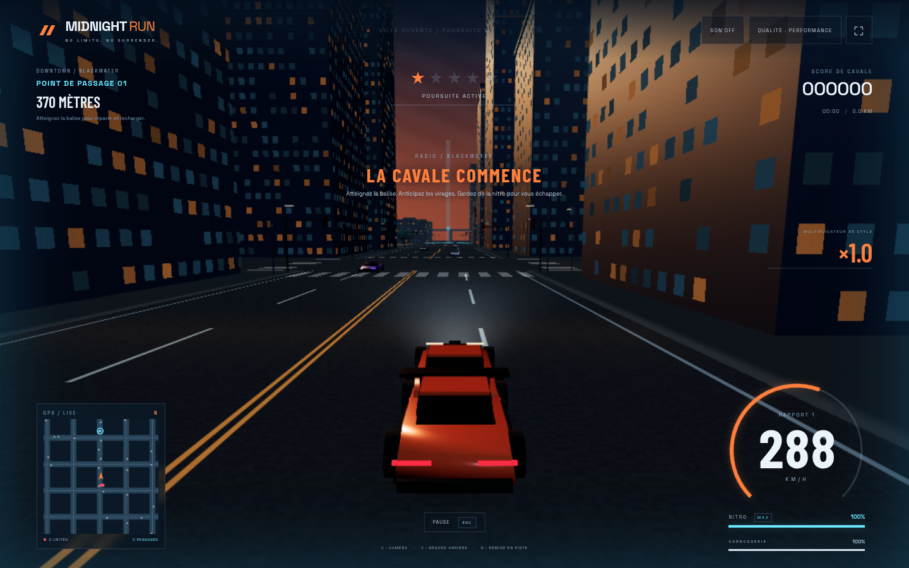

# MIDNIGHT RUN · NO LIMITS

Jeu de poursuite automobile **3D en vue à la troisième personne** : ville, circulation, vitesse extrême, nitro, drift et police.

## Télécharger et jouer

**[Télécharger MIDNIGHT RUN pour Windows (.exe)](https://github.com/ezfn1804-cell/recompilated-pc-port/raw/refs/heads/downloads/midnight-run-1.0.0/Midnight-Run-1.0.0-Windows-x64.exe)**

Windows 10 / 11 **64 bits**. Fichier portable, environ 98.0 Mo. Téléchargez puis lancez-le par double-clic : aucun serveur, compte ou installation de Node.js nécessaire. Le jeu fonctionne hors ligne.

## Le jeu

- Trois voitures : **APEX GT**, **VOLT R** et **BRUTE V8**. La VOLT R approche les **600 km/h** avec la nitro.
- Ville procédurale avec quartiers, parcs, feux et **68 véhicules** de circulation.
- Police avec poursuite, routes sur le réseau de rues, interception prédictive, recherche jusqu’à cinq étoiles et barrages.
- Nitro, drift, frôlements et multiplicateur de score jusqu’à **×5**.
- Points de passage renouvelés : réparations et recharge de nitro.
- Sons de moteur, pneus, collisions et sirènes ; records locaux et qualité graphique réglable.

## Commandes

| Action | Touche |
| --- | --- |
| Accélérer / freiner-reculer | Z/S, W/S ou flèches |
| Diriger | Q/D, A/D ou flèches |
| Nitro | Maj |
| Frein à main / drift | Espace |
| Caméra / regard arrière | C / V |
| Remise en piste | R |
| Pause / plein écran / son | Échap / F11 / M |

L’exécutable de développement est **non signé**. Il a été construit sous Linux ; son lancement natif Windows reste à vérifier sur un PC Windows. Les tests de simulation et Chromium sont exécutés avant publication.

## Sources, intégrité et licences

- [Code source du jeu (.zip)](Midnight-Run-1.0.0-Source.zip) : Node.js 24, puis `npm ci` et `npm run dev` depuis le dossier extrait.
- [Instructions](LIRE-MOI.txt), [empreintes SHA-256](SHA256SUMS.txt), [licences](THIRD_PARTY_NOTICES.txt).
- SHA-256 du `.exe` : `6b16be4df1e7455c7958046d916839c8cdfaa14142e171594627e03199c7c647`.

Cette branche contient la distribution du nouveau jeu ; la branche `main` et le téléchargement précédent de NEON RIFT sont conservés.
